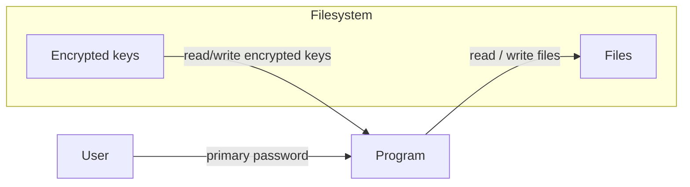

# FiorinoPrego - Design choices

## System architecture

## Threat model

## Chosen technology stack

As this application is meant to work on Linux, a tech stack that I am familiar with and that I believe to be appropriate for the challenge includes...

- C language at the standard C17
  - available in GCC since 2018 (version 8), thus available
  - compiled without GNU extensions for maximum portability
- stick to POSIX APIs for [getting users](https://stackoverflow.com/questions/8953424/how-to-get-the-username-in-c-c-in-linux) and more
- OpenSSL v3.0+, developed on v3.5
  - v3.0 had its EOL this month (september 2026) but still defines the API+ABI
  - v3.5 is the LTS release supported until 2030, shipped by default on most distros
  - I will try my best for compatibility with LibreSSL, as [many prefer it](https://security.stackexchange.com/a/112546/336325) for historical reasons and it is installed by default on MacOS, OpenBSD and other BSD-family operating systems
  - I can enforce OpenSSL backwards compatibility by `-DOPENSSL_API_COMPAT=0x30000000L`

I want to link dynamically against OpenSSL as I know that realistically I won't be able to keep up with every OpenSSL vulnerability.

## Reminders to self

- maybe SELinux policy?
- don't hardcode `gcc` in build scripts

