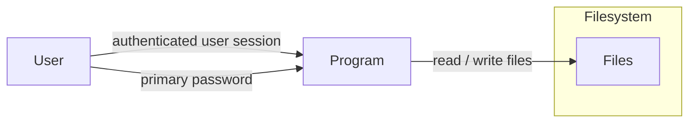

# FiorinoPrego - Design choices

## System architecture



## Threat model

This section presents some modeled threats, derived from the STRIDE identification method, and their respective mitigations.

Some things to remember are that:
- concealing the content of a file is a security requirement, while its size being leaked is not a concern
- the focus of this project is on security rather than on usability, so the aim is to maximize security while retaining usability, rather than vice versa

### Spoofing

Threats.

- someone stealing a valid terminal session
- someone stealing a valid user credentials set
- someone stealing the primary password for a vault of files

Safeguards.

- least privilege: one given user only has access to its own files
- defence in depth: stealing a user account is not sufficient, a primary password is needed to decrypt a vault too
  - one measure is enforced by the kernel, the other one by the user's memory

### Tampering

This category considers security at rest.

Threats.

- deleting the memory where the encrypted files live
- unintentionally overwriting an encrypted file
- tampering with the files in their encrypted form

Safeguards.

- per-user configurable mirrors on different partitions
  - including different disks and NFS
- confirmation dialogs in the user interface
- HMAC for integrity

### Repudiation

Threats.

- exploitation attempt left untraceable, or accountability missing
- logs manipulated
- logs deleted

Safeguards.

- system logging
- system logging with [FSS](https://learn.netdata.cloud/docs/logs-management/systemd-journal-logs/forward-secure-sealing-fss-in-systemd-journal)
  - where it is supported, I guess we can configure it as an optional feature enabled by default
- logs shipped off-machine through Rsyslog
  - where it is enabled, make it a shipped configuration by default

### Information disclosure

Consider that the plaintext contents of the encrypted files are the direct information we strive to protect, while for the passwords and keys the confidentiality is rather needed indirectly to protect the rest of the system.

Threats.

- plaintext file recovered
- list files belonging to another user
- weak keys/passwords

Safeguards.

- safe memory management (of passwords, keys and files)
  - strong, audited cryptography (FIPS standards implemented in OpenSSL) for security at rest
- UNIX permissions/ACLs
- passwords have an entropy requirement and primary keys are derived with PBKDF2

### Denial of service

Threats.

- excessive allocation of disk space
- excessive allocation of memory space
- excessive encryption requests, exhausting compute time

Safeguards.

- verification of free space availability in the destination filesystem and in the mirrors
- baked-in (at compile time) file size limit
- a system wide lock (or semaphore?) to prevent too many concurrent encryptions/decryptions

### Elevation of privileges

Threats.

- privilege escalation to root

Safeguards.

- never running as root, always as the invoking user

### Information loss

Threats.

- program crashing during I/O operations
- concurrent writing to files

Safeguards.

- signal handling
- never overwriting encrypted files, rather writing the new version and then atomically "move" on top
- file locking

See these slides in week 3 materials.
> Creating Files Without Replacing Existing Ones
> Exclusive Access and File Locking

## User interface

```bash
fiorino encrypt -v default -f ./file1.txt ./file2.jpeg
```

- these will be stored as `file1.txt.enc` and `file2.jpeg.enc` alongside a key for each
- the user will be prompted for a password, or a password can be piped through stdin
- unless differently specified with `--no-push`, this will push files and keys to all active mirrors

```bash
fiorino decrypt -v default -f file1.txt file2.jpeg
```

- these will be decrypted from `file1.txt.enc` and `file2.jpeg.enc`
- if keys or files are unavailable in the main storage, they will be retrieved from the latest modified file from any (active?) mirror

### Side functionality

> [!NOTE]
> TODO

- configure a mirror
- activate/deactivate a mirror
- create/delete a vault
- remove a file from a vault
- verify the configuration
- list the files in a vault
- list the vaults

## Configuration

Configuration, was any to be needed, will live in `/etc/fiorino.conf`.

## Application program interface

> [!NOTE]
> Refer to [`fiorino.h`](src/fiorino.h)

## Chosen technology stack

As this application is meant to work on Linux, a tech stack that I am familiar with and that I believe to be appropriate for the challenge includes...

- C language at the standard C17
  - available in GCC since 2018 (version 8), thus available
  - compiled without GNU extensions for maximum portability
- stick to POSIX APIs for [getting users](https://stackoverflow.com/questions/8953424/how-to-get-the-username-in-c-c-in-linux) and more
- OpenSSL v3.0+, developed on v3.5
  - v3.0 had its EOL this month (september 2026) but still defines the API+ABI
  - v3.5 is the LTS release supported until 2030, shipped by default on most distros
  - I will try my best for compatibility with LibreSSL, as [many prefer it](https://security.stackexchange.com/a/112546/336325) for historical reasons and it is installed by default on MacOS, OpenBSD and other BSD-family operating systems
  - I can enforce OpenSSL backwards compatibility by `-DOPENSSL_API_COMPAT=0x30000000L`
<!-- - GnuPG v2.0+
  - GnuPG Made Easy as a C API
  - digital signature [[docs]](https://www.gnupg.org/documentation/manuals/gpgme/Creating-a-Signature.html) -->

I want to link dynamically against OpenSSL as I know that realistically I won't be able to keep up with every OpenSSL vulnerability.

## Reminders to self

- maybe CodeSonar (or was it SonarQube something?) scan before submission
- fix possible race conditions by "memfd"
- maybe SELinux policy?
- use the [Fil-C compiler](https://fil-c.org/) for security testing
- logging with proper [facilities](https://www.manageengine.com/products/eventlog/logging-guide/syslog/syslog-facilities.html)
- we can use `st_dev` to ensure that different mirrors are on different partitions
- consider [this](https://unix.stackexchange.com/questions/452620/is-mv-atomic-operation-between-two-file-systems) when syncing mirrors
- handle the signals!
- consider using the [OpenSSL secure heap](https://docs.openssl.org/3.5/man3/OPENSSL_secure_malloc/#description) at least for the keys
- don't hardcode `gcc` in build scripts

